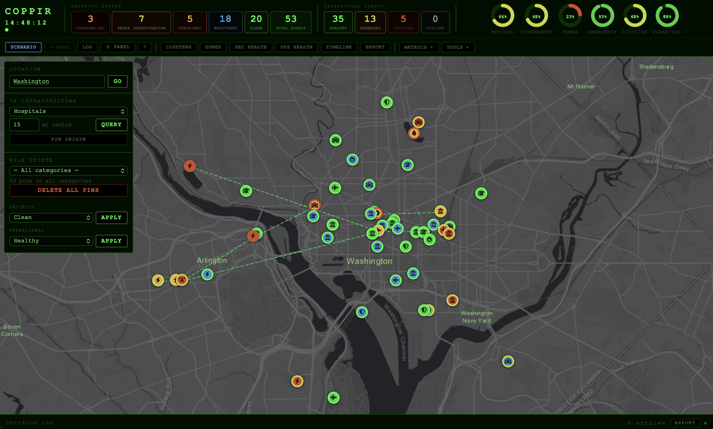

# COPPIR

**Common Operational Picture Program for Incident Response**

COPPIR builds and runs a live common operational picture (a shared map of an incident) for incident response
tabletop exercises. It is one executable for macOS, Windows or Linux. It has no
accounts, no cloud service and no database server. Only map tiles, place search
and OpenStreetMap lookups use the network.



---

## Contents

- [Getting started](#getting-started)
- [Exercises](#exercises)
- [The map](#the-map)
- [Assets and links](#assets-and-links)
- [SITREP strip](#sitrep-strip)
- [Injects](#injects)
- [Decision log](#decision-log)
- [Metrics and thresholds](#metrics-and-thresholds)
- [Taxonomy](#taxonomy)
- [Undo](#undo)
- [Export](#export)
- [Keyboard shortcuts](#keyboard-shortcuts)
- [Development](#development)

---

## Getting started

### Building from source

You need Rust 1.85 or newer and Node 22 or newer. On Linux, also install the
WebKitGTK development packages (`libwebkit2gtk-4.1-dev libgtk-3-dev` on
Debian and Ubuntu).

```bash
npm --prefix web ci && npm --prefix web run build
cargo run --release
```

That opens the desktop window. To run only the server and use your own browser,
add `--headless` and open the address it prints (`http://127.0.0.1:8000` by
default):

```bash
cargo run --release -- --headless
```

To build a server-only binary with no GUI dependencies:

```bash
cargo build --release --no-default-features
```

### Options

| Flag | Env var | Default | |
|---|---|---|---|
| `--port` | `COPPIR_PORT` | `8000` | If the port is taken, the app uses a free one |
| `--strict-port` | | off | Fail instead of falling back to another port |
| `--database` | `COPPIR_DATABASE` | `coppir.db` in the per-user data directory | Where exercises are stored |
| `--scenarios-dir` | `COPPIR_SCENARIOS_DIR` | `scenarios` in the per-user data directory | Where version 1 saved scenarios, so they can be imported |
| `--headless` | | off | Serve only; no window |

The per-user data directory is `~/Library/Application Support/COPPIR` on macOS,
`%APPDATA%\COPPIR\data` on Windows and `~/.local/share/coppir` on Linux.
Logging follows `RUST_LOG`, for example `RUST_LOG=coppir=debug`.

### Loading the demo

To see the interface populated, run the seeder against a running instance:

```bash
cargo run --example seed_demo
```

It builds the exercise in the screenshot: a fictional incident in Washington DC
with 53 assets, dependencies, fired and queued injects, alert thresholds,
metrics, a cordon and a decision log. Each run creates a new exercise and prints
its address. To seed an instance on another port, set `COPPIR_API`.

---

## Exercises

The start page lists your exercises. From there you can:

- **Create** an empty exercise with the default taxonomy.
- **Open** one. You can bookmark its address (`/x/<id>`) or open it in a second
  window. Every window shows the same picture, live.
- **Duplicate** one to run it again from where it stands, or to start from a
  template.
- **Export** one as a `.coppir` file, and **import** that file on another
  machine. Import also accepts scenario `.json` files saved by version 1 or the
  Python app.
- **Delete** one, with its history.

COPPIR writes every change to disk before it appears on screen, so a crash or a
power cut loses nothing. When the start page finds scenarios left by version 1
in the scenarios folder, it offers to import each of them.

---

## The map

The map uses OpenFreeMap's dark vector tiles, which need no API key. Pan by
dragging and zoom with the scroll wheel. The toolbar at the top left holds:

| Tool | |
|---|---|
| **Search** | Find a place by name. Click a result to fly there, or **+ Asset** to add an asset at it. |
| **Add asset** (A) | Click the map to place a new asset. |
| **Measure** (M) | Click points to build a path; the running distance shows on the map. Double-click or Esc to finish. |
| **Draw** | Mark up the map with points, lines, freehand lines, polygons, rectangles or circles, in any colour. Every window sees your drawings, and COPPIR saves them with the exercise. Click a drawing to label it, recolour it or delete it. |
| **Lock** | Freeze panning and zooming, so a drawing stroke cannot drag the map. |
| **Layers** | Turn marker clustering, sector zones, links, drawings, asset names and the legend on or off, or show a heat map of either status. |

Right-click the map to add an asset there, search OpenStreetMap around that
point, measure from it, or copy its coordinates.

**Sector zones** outline each sector's assets and colour the area by the
sector's health. Hover a zone to list its assets. **Heat maps** weigh each asset
by how bad its status is, so trouble spots glow.

### Reading a marker

Each marker carries both statuses twice, so the picture reads without colour:

| | Colour | Second cue |
|---|---|---|
| Security (fill set) | Marker fill | Glyph badge: ✕ Compromised, ? Under Investigation, ▪ Contained, ◦ Monitored, ✓ Clean |
| Operational (ring set) | Marker ring | Ring style: solid Healthy, dashed Degraded, double Critical, dotted Offline |

The icon in the middle is the asset type. COPPIR builds the legend at the bottom
left from the exercise's own taxonomy, so it always matches the markers.

---

## Assets and links

The **Assets** tab lists everything on the map.

- **Find** by name or tag. The map shows only the matches. Press Enter to zoom
  to them.
- **Asset types** toggles show or hide whole types.
- **Bulk status change** sets one status on every asset, or every asset of one
  type, at once.
- **Import from OpenStreetMap** searches for real infrastructure near the map
  centre or a right-clicked point: hospitals, government buildings, power
  plants, fire and police stations, data centres, universities, banks, water
  systems, transport hubs and telecom sites. Choose which results to keep and
  add them in one step.

Select an asset on the map or in the list to edit it. You can rename it, set
each status, change its type or colour, write notes, add tags, or move it. The
editor also shows every status change with its time.

**Links** record how assets relate: *depends on*, *is managed by* or *connects
to*, with an optional label. Dependencies draw as dashed amber lines, and other
links as solid green lines. Removing an asset removes its links.

---

## SITREP strip

The strip under the title bar summarises the picture as it changes:

- the asset count, and a count for each value of each status set;
- one wheel per sector, showing the mean health score of its assets;
- your custom metrics;
- every alert threshold that is currently breached.

All of it comes from the taxonomy, so custom statuses and sectors appear without
any code change.

---

## Injects

Injects are scripted events that the facilitator queues before the exercise and
fires during it. In the **Injects** tab, **New inject** takes:

- a title and the text players see;
- a severity: info, warning or critical;
- any number of effects: change an asset's status, or create a new asset at a
  point you click;
- facilitator notes, which players do not see.

**Fire** applies every effect at once, writes an automatic log entry, and shows
a banner across the map in every window. An inject fires only once. Undo takes
the whole firing back.

---

## Decision log

The **Log** tab records decisions and actions. Type an entry, optionally attach
it to an asset, and press Enter. Fired injects log themselves, and COPPIR marks
those entries AUTO. The list follows new entries, and stops following while you
scroll up to read history. The **Timeline** view lays entries out in time, so
gaps and bursts of activity stand out. **CSV** downloads the whole log.

---

## Metrics and thresholds

In the **Setup** tab:

- **Metrics** are percentages you set by hand, such as comms readiness or staff
  available. They appear as wheels in the SITREP strip. Adjust them by ±5, click
  the wheel to type an exact value, or click the name to rename it.
- **Alert thresholds** watch a sector, or the average of all sectors. When its
  health drops below the threshold, the SITREP shows the alert and outlines the
  sector's wheel in red.

Metrics and thresholds belong to the exercise, so every window sees the same
values.

---

## Taxonomy

**Taxonomy** in the title bar edits the exercise's vocabulary:

- **Statuses**: any number of status sets, each an ordered list of values with a
  colour, a glyph and a health score from 0 to 100. One set fills the markers,
  one draws their rings, and the rest show in the asset editor only.
- **Asset types**: a name, a colour and any [Lucide](https://lucide.dev/icons)
  icon.
- **Sectors**: groups of asset types, each with a health wheel driven by the
  status set you choose.

The default reproduces the original COPPIR vocabulary. Changes apply to every
window at once. If you remove a status value, assets that had it fall back to
the set's starting value. You cannot remove an asset type while assets still
use it.

---

## Undo

**Undo** in the title bar, or Ctrl/⌘+Z, reverses the most recent change of any
kind: a status change, a deleted asset, a fired inject, a drawing. It reaches
back 100 changes. If a later change touched the same asset, undo stops
instead of overwriting that later work. Undo appends to the history rather than
erasing it, so the record of the exercise stays complete.

---

## Export

The **Export** menu offers:

- **Decision log (CSV)**, for the after-action report. COPPIR neutralises cells
  that would start a spreadsheet formula.
- **Briefing (HTML)**, a printable document with status counts, sector health,
  metrics, every asset and the last 30 log entries.
- **Exercise file (.coppir)**, the whole exercise, to back up or move to another
  machine.
- **Duplicate exercise**.

In the desktop window, downloads go to your Downloads folder.

---

## Keyboard shortcuts

| Shortcut | Action |
|---|---|
| Ctrl/⌘+Z | Undo |
| Ctrl/⌘+K | Find an asset |
| Ctrl/⌘+L | Decision log |
| A | Add an asset |
| M | Measure |
| Esc | Cancel the current tool, or clear the selection |
| ? | Show this list |

---

## Development

```bash
cargo test --no-default-features              # Rust unit and API tests
cargo clippy --all-targets --all-features -- -D warnings
cargo fmt
npm --prefix web run check                    # svelte-check; warnings are errors
npm --prefix web test                         # vitest
```

For frontend work, run the server with `cargo run -- --headless` and, in
another shell, `npm --prefix web run dev`. Vite serves the app with hot reload
at `http://localhost:5173` and forwards `/api` to the server. A debug build of
the Rust binary reads `web/dist/` from disk, so a fresh `npm run build` shows up
on reload without recompiling.

`cargo test` generates the TypeScript types in `web/src/lib/types/` from the
Rust types. Commit them with the Rust change. CI fails if they are stale.

See [ARCHITECTURE.md](ARCHITECTURE.md) for how the pieces fit together, and
[docs/DESIGN.md](docs/DESIGN.md) for where the project is going.

---

## License

Licensed under the Apache License, Version 2.0. See [LICENSE](LICENSE).
